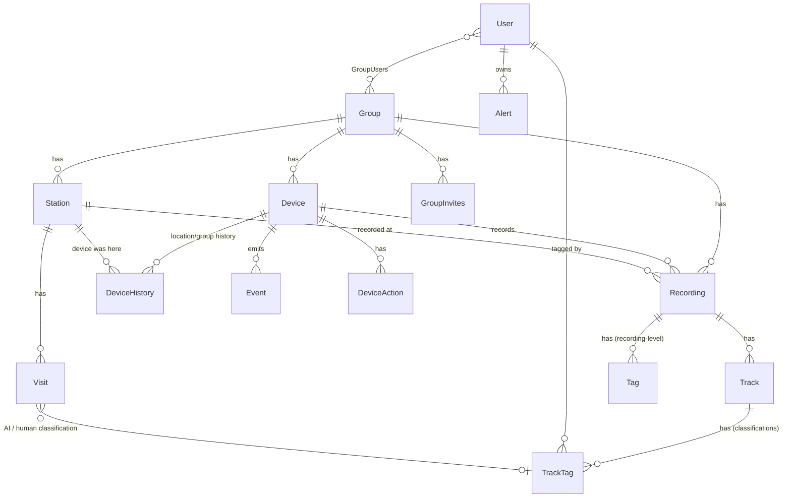

# Data Model

This document explains the core relationships in the Cacophony API database
(PostgreSQL, accessed through Sequelize). It is aimed at developers new to the
API server. It covers the main tables and how they connect, not every column.

The source of truth is the model definitions in [`models/`](./models) (see the
`addAssociations()` method on each model) and the migrations in
[`migrations/`](./migrations). 
If this document disagrees with them, they take precedence.

Conventions:

- Table names are plural (`Recordings`). Foreign keys are typically named
  `<Model>Id` (`GroupId`, `DeviceId`), but there are some exceptions to this.
- Large binary content (recordings, track data, user files) is not in the
  database. Rows hold keys (`fileKey`, `rawFileKey`) into an S3-compatible
  object store.

## Overview

**Users** belong to **Groups** (many-to-many). A **Group** owns
**Devices** and **Stations**. Devices upload **Recordings**. Each Recording
belongs to the Group, Device and (usually) Station it was made at, and
contains **Tracks** (things detected in it), each of which carries
**TrackTags** (what the track is, according to an AI model or a person).
On the front-end, **Groups** are usually referred to as **Projects** 
and **Stations** are called **Locations**. 

## Ownership and access

### Group/Project

The top-level unit of ownership and permissions. Devices, stations and
recordings all belong to exactly one group. `groupName` is unique. `settings`
(JSONB) holds group-wide configuration. The group also caches
`earliest/lastThermalRecordingTime` and `earliest/lastAudioRecordingTime`
for quick display.

### User and GroupUsers

Users and groups are many-to-many through `GroupUsers`. The join row carries
the permissions and state of the membership:

- `admin`, `owner`: role flags.
- `pending`: `null` for an active member, otherwise `"requested"` (the user
  asked to join) or `"invited"` (a group admin invited them).
- `removedAt`: members are soft-removed. The row is kept until after the next
  billing cycle so their resource usage (`transferredItems`,
  `transferredBytes`) can still be attributed to the group.  Note that this 
  is infrastructure for future capabilities - there is currently no billing cycle.
- `settings`: per-user group settings (JSONB).

`GroupInvites` holds invitations sent by email to people who may not have an
account yet (`email`, `invitedBy`, `admin`, `owner`).

Users also own `Alert`s, which are rules about getting notifications when a
user-defined classification is made across various scopes: group-level,
station-level or device-level.

## Camera Hardware and location

### Device

A single **DOC AI Camera**, the custom hardware device created by The Cacophony 
Project, capable of recording thermal video and separately, birdsong audio.

Belongs to one Group. `deviceName` is unique, and `password` is stored hashed.
`uuid` and `saltId` identify the physical device for authentication.
It caches first/last recording times for thermal and audio, and
`lastConnectionTime`.

`active` is `false` for devices that have been superseded 
(this can be when a physical device is moved to another `Group`, or when a 
device is retired). 
**Re-registering a device (renaming it or moving it between groups) creates a 
new `Device` row** that shares the old one's `uuid`/`saltId`, and marks the old 
one inactive. So "the same physical device" can be several `Device` rows over time, 
and the history of that is kept in `DeviceHistory`.

### Station/Location

A named location within a Group where one or more devices are (or were) deployed,
with `location`, `activeAt` and `retiredAt`. Stations can be created by users
or automatically (`automatic`, `needsRename`), for example when a device
reports a new location. A device is not tied to a station directly. See
`DeviceHistory`.  There are rules about how close stations can be to each other.

### DeviceHistory

A time-ordered log of where a device was and how it was configured. Each row
has `DeviceId`, `GroupId`, `stationId` (note the lowercase `s`), `location`,
`fromDateTime`, `settings` (JSONB), and `setBy` (what caused the change, e.g.
`re-register`). It also snapshots `deviceName`, `uuid` and `saltId` as they
were at that time.

This is how a recording gets its Station. When a recording is uploaded, the
device's history at the recording's `recordingDateTime` determines which
station (and group) it is assigned to.

### DeviceAction and Event

- `Event` is something a device reports (e.g. power-on, a trap going off).
  It points to a `Device` and to a `DetailSnapshot` (`EventDetailId`), which
  holds the event `type` and `details` JSONB. `DetailSnapshot` rows are
  shared and deduplicated across events that share common details.
- `DeviceAction` tracks a request from a device for a user to approve an action
  to do something (such as trap-related actions). 
  It has a `status`, a `history` of state transitions, a `DeviceId` and an 
  optional `RecordingId` for a related recording of the event.

## Recordings and what's in them

### Recording

One audio or thermal video recording (`type`). It belongs to a `Group`, a
`Device`, and a `Station`. Key columns:

- Metadata: `recordingDateTime`, `duration`, `location`, `additionalMetadata` (JSONB).
- Files: `rawFileKey` (as uploaded) with matching size/mime/hash columns.  
  In the past recordings had both a raw and a processed representation, but currently
  the raw representation is used throughout backend and frontend.
- Processing: `processingState`, `processing`, `processingStartTime`,
  `processingEndTime`, `processingFailedCount`, `jobKey`.
- Uploader: `uploader` (`"device"` or `"user"`) and `uploaderId`.
- Lifecycle: soft-deleted with `deletedAt`/`deletedBy`. `redacted` and
  `public` control visibility.

### Track

A detected object or sound within a Recording: a thermal object followed
across frames, or an audio region (`startSeconds`, `endSeconds`,
`minFreqHz`, `maxFreqHz`). `archivedAt` soft-archives a track. 
The detailed track data (e.g. per-frame positions) is stored in the 
object store, not the database.

### TrackTag

A classification of a Track, e.g. `what = "possum"`, with an ltree `path`
(taxonomy position) and `confidence`. Each is either:

- `automatic = true`: produced by a classification model (`model` names which
  one), with `UserId` null, or
- `automatic = false`: entered by a person (`UserId` is the tagger).

`used` and `archivedAt` track whether it is current. `TrackTagUserData`
(one-to-one) holds optional extra details a user can add: `gender`,
`maturity`.

### Tag

A **recording-level** tag, i.e. one that applies to the recording rather 
than to a specific track.
It has `what`, `detail`, `confidence`, `automatic`, `comment` and a
`tagger` (User). Track-level classification (`TrackTag`) is what the current UI and
classification pipeline are built around, and `Tag` is the older model.
Tags are currently still used to allow a per-user comment thread on a recording.

## Derived data

### Visit

A summary of one animal's presence at a Station over a period (`startTime`,
`endTime`), built by grouping together the recordings in `recordingIds`.
It has a `StationId` and `GroupId`, and records the "best" classification
from two sources: the AI and humans. For each it stores the Recording and
TrackTag the classification came from
(`aiClassificationRecordingId` / `aiClassificationTrackTagId`,
`humanClassificationRecordingId` / `humanClassificationTrackTagId`).
Visits are recomputed from recordings and tags, so they can be rebuilt.

### Alert

A user's notification rule (`conditions` JSONB, `frequencySeconds`,
`lastAlert`). It belongs to a `User` and may be scoped to a `Device`,
`Station` or `Group`.

## Things to be aware of

- Use `DeviceHistory` to find out where a device was at a given time.
- **Soft deletion is common.** Check `deletedAt` (recordings), `archivedAt`
  (tracks, track tags), `removedAt` (group members) and `retiredAt`
  (stations) before assuming a row is live.
- **JSONB columns hold flexible settings** (`settings`, `additionalMetadata`,
  `conditions`). Their shapes are defined by the TypeScript types
  under `types/`, not by the database.
